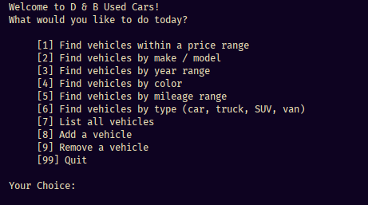
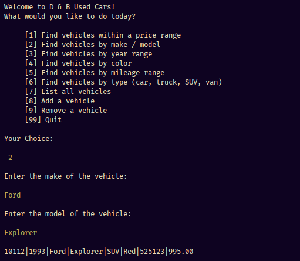

# Car Dealership Workshop

A console based object-oriented car dealership application.

## Description of the Project

This application is composed of different classes that work together to simulate a car dealership. It reads and overwrites
the inventory file. The project was layered, and it was good practice for this rather complex topic.


## Features

- Find vehicles within a price range
- Find vehicles by make / model
- Find vehicles by year range
- Find vehicles by color
- Find vehicles by mileage range
- Find vehicles by type (car, truck, SUV, van)
- List ALL vehicles
- Add a vehicle
- Remove a vehicle
- Quit

## Setup

### Prerequisites

- Java 17 (Amazon Corretto), the version used in class.
- IntelliJ IDEA Community Edition: <https://www.jetbrains.com/idea/download/>

### Running the application

1. Clone this repository, or download it as a zip and unzip it.
2. In IntelliJ: File > Open, pick the project folder (the one that holds `pom.xml`), press Open.
3. Wait for IntelliJ to finish indexing (progress bar at the bottom).
4. Open `src/main/java/com/pluralsight/Program.java`. 
5. Right-click inside the file and choose Run 'Program.main()'.

### Data and configuration

- `inventory.csv` sits at the project root, next to `pom.xml`. The program reads it at start.

## Technologies Used

- Java 17
- IntelliJ IDEA

## Demo

<!-- Pictures of the app running: the console for a console app, Insomnia or Swagger for an API.
     Screenshots are enough; a GIF is a bonus.
     1. Create a folder named `images` at the project root, next to `pom.xml`.
     2. Take screenshots of the app in the IntelliJ console (the menu, one feature, one error message):
          Windows: Win + Shift + S, drag a rectangle, then paste into Paint and save as PNG, or open the
                   notification and save. Save into the `images` folder.
          Mac:     Shift + Cmd + 4, drag a rectangle. The file lands on the Desktop; move it into `images`.
     3. Name the files by what they show: `images/menu.png`, `images/search.png`.
     4. Reference each one below with a relative path. No spaces in file names.
     5. Commit the images with the rest of your work (Git > Commit shows them as unversioned files: tick them).
     Optional GIF: LICEcap (free, Windows and Mac, <https://www.cockos.com/licecap/>) records a region of the
     screen straight to a .gif. Keep it under 10 seconds and under 10 MB, save it into `images`. -->





## A piece of code I am proud of


These are helper methods I created as a safety net for incorrect entries. I realized that I had a large
block of code and one mistype could cause the user to have to reboot the whole program and reenter all their information,
so, I added a catch for it.

```java
//helper methods
private int getValidInt(String prompt) {
        while (true) {
            try {
                System.out.println(prompt);
                return Integer.parseInt(scanner.nextLine().trim());
            } catch (NumberFormatException e) {
                System.out.println("\nInvalid input. Please enter a whole number.\n");
            }
        }
    }

    private BigDecimal getValidBigDecimal(String prompt) {
        while (true) {
            try {
                System.out.println(prompt);
                return new BigDecimal(scanner.nextLine().trim());
            } catch (NumberFormatException e) {
                System.out.println("\nInvalid input. Please enter a valid price.\n");
            }
        }
    }
```

## Future Work

- A more aesthetically pleasing menu

## Resources

<!-- What helped you: the workbook, the week's hub pages, a tutorial, a documentation page. Real links. -->

- Java YearUp Fall 2026 hub: <https://raymaroun.github.io/yearup-java-fall2026/>
- Visual hub: https://raymaroun.github.io/yearup-java-fall2026/week-05/exercises/car-dealership.html

## Author

- **Amanda Charles**

## Thanks


- Thank you to Raymond for his help, and patience.
